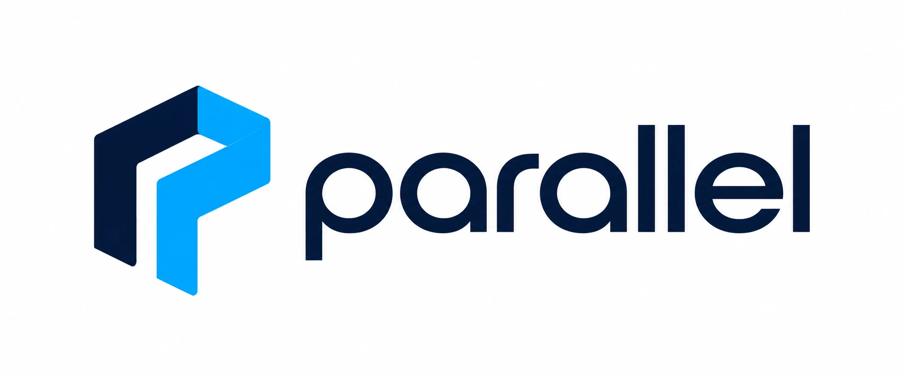

<p align="center"></p>

# Parallel

Parallel takes a recorded environment to a documented decision:
**Capture → Reconstruct → Prepare → Simulate → Compare → Improve.**

Photographs, video or drone footage of a real place become a scene that can be measured. Simplified,
editable models are prepared from it with the provenance of every input recorded. Established
engineering engines run scenarios on those models, the results are normalised, cross-checked against
each engine's own output and compared under controlled conditions, and reports state what was tested
and what the results support.

The platform's credibility rests on one rule: **an impressive picture is never presented as a
calculation.** Visual reconstruction is never treated as physical validation, unavailable engines are
reported as unavailable, metrics come only from real engine runs, and AI suggestions are used only
after a person adopts them.

## Modules

| Module | What it answers | Engines |
| --- | --- | --- |
| **Mine Evacuation** | How long does a section take to clear, and what changes it: blocked routes, refuges, escapeways? | JuPedSim; Ventsim, FDS, FLAC3D and 3DEC for ventilation, fire and ground studies |
| **CrashLens** | Which hypotheses about a collision does the evidence support, and how closely does each fit the measurements? | Virtual CRASH or PC-Crash (licensed, file exchange); built-in skid-to-stop calculation |
| **Construction Sites** | How do site logistics and evacuation perform under alternative layouts? | JuPedSim, SimPy, SUMO or Isaac Sim, FLAC3D or 3DEC, OpenFOAM |
| **Urban Planning** | How does a transport, public-space or building change perform, without mistaking unfinished trips for gains? | SUMO, JuPedSim, SWMM, EnergyPlus with OpenStudio, OpenFOAM |
| **Urban Drainage** | Where does a network flood under a design storm, and does an intervention help? | SWMM, EPANET, HEC-RAS |

All fifteen engines in the specification are integrated; their verified status on each platform is in
[docs/engine-matrix.md](docs/engine-matrix.md).

## What is in this repository

```
apps/web                 React + TypeScript browser application (Three.js scene workspace, Spark splats)
services/api             FastAPI HTTP API, demonstration package, admin commands, AI assistant
workers/simulation       Celery worker: engine runs, external results, recovery, engine availability
workers/reconstruction   Celery worker: capture processing, COLMAP, scale alignment, scene publication
workers/results          Celery worker: PDF, CSV and JSON reports from one manifest
packages/contracts       Pydantic data contracts: provenance, geometry, scenes, domain models, runs
packages/scene           Geometry validation, coordinate transforms, PLY handling, measurement checks
packages/metrics         The metric registry and controlled comparison
packages/engines         Engine capability records, adapters, runners, file exchange, reference models
packages/core            Database models, migrations, access control, jobs, storage, backups
infra/docker             Container images (app, worker, web) and nginx configuration
compose.yaml             Single-host deployment
docs/                    Specification, architecture, contracts, status, validation and guides
```

## Quick start (development)

Requirements: Python 3.13 (3.12 supported), [uv](https://docs.astral.sh/uv/), Node 22, PostgreSQL 16
with PostGIS, Redis 7, and for reconstruction `colmap` and `ffmpeg`.

```bash
uv sync                                   # Python workspace
scripts/setup_runtimes.sh                 # isolated engine runtimes (JuPedSim, SUMO, SWMM, EPANET, SimPy, OpenStudio)
cp .env.example .env                      # defaults suit a local PostgreSQL and Redis
uv run alembic upgrade head               # database schema
uv run python -m parallel_api.admin create-admin --email you@example.org --organisation "Your organisation"

uv run uvicorn parallel_api.main:app --port 8000
uv run celery -A parallel_simulation.worker worker -Q cpu,gpu,maintenance -n sim@%h
uv run celery -A parallel_reconstruction.worker worker -Q reconstruction -n recon@%h
uv run celery -A parallel_results.worker worker -Q results -n results@%h
uv run celery -A parallel_simulation.worker beat
(cd apps/web && npm ci && npm run dev)    # http://localhost:5173
```

Demonstration projects, built by running the real engines once:

```bash
PARALLEL_DEMO_PASSWORD=choose-one uv run python -m parallel_api.demo seed
uv run python -m parallel_api.demo status
uv run python -m parallel_api.demo reset   # restores them; other projects are never touched
```

## Deployment

```bash
cp .env.example .env    # set PARALLEL_SECRET_KEY and POSTGRES_PASSWORD
docker compose up -d --build
docker compose run --rm api python -m parallel_api.admin create-admin --email you@example.org --organisation "Your organisation"
```

The stack (PostGIS, Redis, API, simulation, reconstruction and results workers, scheduler, nginx with
the web application) was built and verified end to end on this branch; see
[docs/deployment.md](docs/deployment.md) for hosted services, GPU workers, licensed installations,
S3 storage, single sign-on, backups and upgrades.

## Tests

```bash
uv run pytest                              # 158 tests: real PostgreSQL, real engines, real reconstruction
uv run ruff check .
(cd apps/web && npm run typecheck && E2E_PASSWORD=... npm run e2e)   # 17 browser tests
```

Engine tests run the pinned engines and fail, rather than skip, when a runtime is missing. What was
verified, how, and on which platform is in [docs/validation.md](docs/validation.md).

## Documentation

| Document | Contents |
| --- | --- |
| [Architecture](docs/architecture.md) | Components, data flow, job lifecycle, storage, security model |
| [Data contracts](docs/data-contracts.md) | Provenance, coordinates, scenes, domain models, scenarios, result envelopes, normalisation, reports |
| [Engine matrix](docs/engine-matrix.md) | Every engine: role, licence, modes, tested versions, limitations, availability (generated) |
| [Engine verification record](docs/engine-verification.md) | Every native cross-check with its tolerance and rationale, from real reference runs (generated) |
| [Metric catalogue](docs/metrics.md) | Every metric's definition, calculation, sources and missing-value rule (generated) |
| [HTTP API](docs/api.md) | Endpoints by area, with the [OpenAPI document](docs/api/openapi.json) (generated) |
| [Reconstruction](docs/reconstruction.md) | Capture guidance, the pipeline, setup and a worked example |
| [Demonstration guide](docs/demo-guide.md) | The five demonstrations, presenter notes, seeding and reset |
| [Validation](docs/validation.md) | Test strategy, engine verification, access control, backups, end-to-end and container checks |
| [Benchmarks](docs/benchmarks.md) | Measured workloads with the host recorded |
| [Deployment](docs/deployment.md) | Local, single-host, hosted, GPU and licensed-engine deployment; operations |
| [Implementation status](docs/implementation-status.md) | Status of every specification area, and known limitations |
| [Specification](docs/PARALLEL_DEVELOPMENT_SPEC.md) | The development specification this implementation follows |

## Acknowledgements

The reconstruction stage sequence follows the 3D Gaussian Splatting pipeline published at
[rakeshsuthar6322/3d_gaussian_splatting_for_model_city](https://github.com/rakeshsuthar6322/3d_gaussian_splatting_for_model_city)
(FFmpeg frame extraction, blur filtering, COLMAP, Splatfacto training, PLY export, collision mesh).
That repository has no open-source licence, so none of its code is used: Parallel's pipeline is an
independent implementation. Engines are used under their own licences, listed in the engine matrix.
