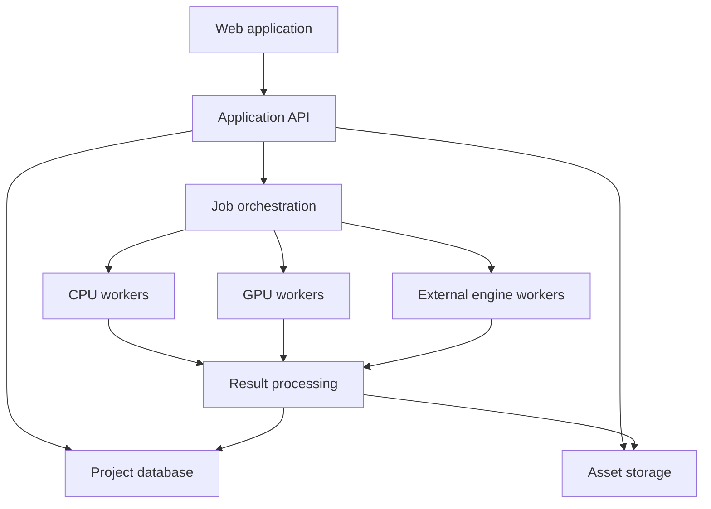

# Parallel — Full Development Specification

**Version:** 1.0  
**Product:** Parallel  
**Purpose:** Implementation specification for Claude Code  
**Status:** Build requirements; this document does not imply that the described features already exist.  

## 1. Instructions to Claude Code

Build Parallel as a working platform for reconstructing real environments, preparing simulation models, running specialist simulations and comparing possible changes.

The five demonstration modules are:

1. Mine Evacuation.
2. CrashLens — Accident Scene Reconstruction and Investigation.
3. Construction Sites.
4. Urban Planning.
5. Urban Drainage.

Include every simulation engine listed in this specification within the integration architecture and implementation scope.

Before making changes:

- Inspect the repository, existing application, configuration and repository instructions.
- Identify working functionality that can be reused.
- Document material differences between the existing implementation and this specification.
- Preserve unrelated user changes.
- Use current official documentation when implementing third-party integrations.
- Pin tested dependency and engine versions.

Build complete workflows with real persistence, background processing and engine results. A polished interface with simulated processing, arbitrary metrics or disconnected controls does not satisfy this specification.

When an engine requires unavailable software, hardware, credentials or licences, implement its integration contract and configuration pathway, document the dependency and show its actual availability. Do not report an unavailable integration as completed.

Work through the dependency-based implementation sequence in Section 29. Continue through work that is possible without requesting confirmation for routine engineering decisions.

---

## 2. What Parallel Does

Parallel transforms recorded environments into digital workspaces where users can inspect conditions, prepare models, test changes and understand their consequences.

Its central workflow is:

Capture → Reconstruct → Prepare → Simulate → Compare → Improve

Users should be able to:

- Capture an environment using photographs, video, drone imagery or existing survey data.
- Reconstruct and inspect a navigable visual representation.
- Add measurements, objects, infrastructure, evidence and operational information.
- Create alternative scenarios.
- Run appropriate simulation engines.
- Watch results in context.
- Compare outcomes against a baseline.
- Request AI assistance in preparing scenarios and interpreting results.
- Export reports containing inputs, assumptions, results and their provenance.

Parallel’s distinctive contribution is the shared workflow connecting reconstruction, specialist modelling, simulation and decision support.

It must preserve the differences between disciplines. A pedestrian simulation, a drainage network and a geomechanical model require different inputs and calculations.

---

## 3. Product Scope

### 3.1 Five demonstration modules

| Module | Main question |
| --- | --- |
| Mine Evacuation | How do route availability, population and movement assumptions affect evacuation? |
| CrashLens | What evidence was captured, and which proposed event sequences are consistent with it? |
| Construction Sites | How do site layout, work phases, access routes and resource allocation affect operations and evacuation? |
| Urban Planning | How do proposed changes affect traffic, pedestrian movement and selected infrastructure outcomes? |
| Urban Drainage | How does a drainage system respond to rainfall and infrastructure changes? |

### 3.2 Full engine scope

The platform must accommodate:

- JuPedSim.
- NVIDIA Isaac Sim.
- SUMO.
- NIST Fire Dynamics Simulator.
- EPA SWMM.
- EPA EPANET.
- HEC-RAS.
- SimPy.
- Ventsim.
- OpenFOAM.
- FLAC3D.
- 3DEC.
- EnergyPlus.
- Virtual CRASH.
- PC-Crash.

OpenStudio provides model preparation and workflow support for EnergyPlus.

These engines are capabilities within Parallel. They do not all run for every project.

### 3.3 Scope distinction

There are three separate deliverables:

1. Shared platform: reconstruction, editing, scenarios, execution, comparison, AI and reporting.
2. Five demonstration workflows: complete examples using appropriate capabilities.
3. Engine integrations: verified execution or verified external exchange for every listed engine.

Registering an engine in a catalogue is only part of its implementation.

---

## 4. Foundational Engineering Rules

### 4.1 Separate visual reconstruction from simulation models

Maintain distinct representations:

| Representation | Contents |
| --- | --- |
| Visual representation | Gaussian splats, photographs, textures, point clouds and visual meshes. |
| Spatial representation | Coordinates, measured geometry, terrain, object locations and reference systems. |
| Domain models | Walkable areas, drainage networks, road networks, ventilation networks, thermal zones or geomechanical models. |
| Scenario representation | Proposed changes, assumptions and operating conditions. |
| Results representation | Engine outputs, derived metrics, trajectories and fields. |

A photorealistic reconstruction does not automatically contain suitable collision geometry or physical properties. NVIDIA’s reconstruction workflow also adds collision geometry for physical interaction.

### 4.2 Preserve information provenance

Every important input must identify its origin:

- Measured.
- Imported from a named source.
- Entered as an assumption.
- Estimated by an algorithm.
- Suggested by AI.
- Derived from another recorded value.

Store source references and uncertainty where available.

An AI suggestion becomes an adopted model input only after an explicit user action in the application.

### 4.3 Use engines for numerical results

LLMs may prepare, organise and explain work.

Numerical simulation results must come from:

- A recorded engine execution.
- A traceable imported engine result.
- An explicitly defined calculation with its formula and inputs.

Never generate plausible-looking numerical results to fill an incomplete workflow.

### 4.4 Preserve reproducibility

Every run must retain:

- Scene revision.
- Domain model revision.
- Scenario revision.
- Engine and adapter versions.
- Input files and hashes.
- Random seeds where applicable.
- Solver settings.
- Execution environment information.
- Raw outputs.
- Normalised results.
- Warnings and errors.

---

## 5. Users and Access

Support organisations, projects and project membership.

| Role | Permissions |
| --- | --- |
| Organisation administrator | Manage membership, integrations and organisation settings. |
| Project editor | Upload captures, edit models, create scenarios and run simulations. |
| Reviewer | Inspect and review models, assumptions and reports. |
| Viewer | View permitted scenes and results. |
| Case investigator | Work on assigned CrashLens cases. |
| Case reviewer | Review evidence annotations, hypotheses and case reports. |

Case access must be explicitly assigned. Ordinary access to an organisation must not automatically expose every investigation.

Review records must identify what was reviewed: geometry, evidence annotations, model assumptions or interpretation. A review must not silently imply broader technical certification.

---

## 6. Application Structure

### 6.1 Main navigation

Provide:

- Projects.
- Demonstrations.
- Engine Library.
- Reports.
- Organisation Settings.

Inside a project, provide:

- Overview.
- Captures.
- Scene Workspace.
- Models.
- Scenarios.
- Runs.
- Compare.
- Reports.
- Activity.

CrashLens projects additionally provide:

- Evidence.
- Timeline.
- Hypotheses.
- Case Review.

### 6.2 Project creation

Project creation collects:

- Name.
- Project type.
- Description.
- Location, if relevant.
- Coordinate/reference information, if known.
- Membership.
- Optional demonstration template.

Users must be able to start from captures, existing model files or a prepared example.

---

## 7. Interface Requirements

### 7.1 Visual direction

Use the Parallel identity:

- Midnight navy.
- Electric cyan accents.
- Clean typography.
- Clear, restrained panels.
- Strong scene visibility.
- Readable numerical results.

Use the supplied logo when its actual asset is available. Do not redraw or substitute an unrelated mark.

### 7.2 Scene workspace

The desktop workspace contains:

- Central 3D viewport.
- Left panel for scene layers and objects.
- Right panel for selected-object properties.
- Bottom playback timeline.
- Toolbar for selection, measurements, annotations and views.
- Contextual access to AI assistance.

Support:

- Orbit, pan and zoom.
- Top-down view.
- Fit to scene.
- Named viewpoints.
- Layer visibility.
- Object selection.
- Measurement tools.
- Annotation markers.
- Simulation playback.
- Side-by-side comparison.

### 7.3 Visual and analytical views

Provide three views:

1. Captured view: original reconstruction.
2. Model view: simplified, editable analytical geometry.
3. Combined view: reconstruction with model and result overlays.

When a scenario moves an object whose appearance remains embedded in the captured reconstruction, make that discrepancy visible. Do not show an unchanged visual scene as though the captured object has physically moved.

### 7.4 Accessibility

Target WCAG 2.2 AA for application controls.

Provide:

- Keyboard-accessible forms and navigation.
- Visible focus indicators.
- Text labels alongside status colours.
- Accessible tables corresponding to charts.
- Reduced-motion support.
- Non-3D access to key project information and results.

The desktop interface supports full editing. Tablet and mobile layouts support inspection, uploads, annotations and result review, with editing capabilities adapted to screen size.

---

## 8. System Architecture

Use a modular backend with independently deployed processing workers.



#### Responsibilities

#### Application API

- Authentication and authorisation.
- Projects and memberships.
- Scene and model revisions.
- Scenario validation.
- Job submission.
- Comparison and reporting.
- AI tool access.

#### CPU workers

- File validation.
- Geometry processing.
- Appropriate CPU simulations.
- Result normalisation.
- Report generation.

#### GPU workers

- Reconstruction training.
- GPU-dependent processing.
- Isaac Sim workloads where configured.

#### External engine workers

- Vendor-specific installations.
- OS-specific execution.
- Licensed workstation integrations.
- Verified file exchange workflows.

Keep expensive computation outside synchronous web requests.

Do not require one Python environment to contain every engine.

---

## 9. Recommended Technology Stack

| Layer | Technology | Purpose |
| --- | --- | --- |
| Frontend | React, TypeScript, Vite | Application interface. |
| Browser geometry | Three.js | Models, annotations and playback. |
| Gaussian rendering | Spark | Captured Gaussian scenes. |
| Geographic map | MapLibre GL JS | Georeferenced project context. |
| Server state | TanStack Query | API state and cache management. |
| API | FastAPI, Pydantic | Typed application services. |
| Database | PostgreSQL with PostGIS | Records and spatial data. |
| Migrations | Alembic | Database changes. |
| Object storage | S3-compatible service | Captures, models and results. |
| Background execution | Celery and Redis | Task dispatch and worker coordination. |
| Media processing | FFmpeg | Video inspection and frame extraction. |
| Camera reconstruction | COLMAP | Camera poses and structure from motion. |
| Visual reconstruction | Nerfstudio/Splatfacto | Gaussian scene training. |
| Geometry processing | Open3D, Shapely | Point-cloud and planar geometry operations. |
| Geospatial processing | GDAL, Rasterio, PyProj | Terrain, raster and coordinate handling. |
| Result storage | Parquet and suitable field formats | Large time series and spatial outputs. |
| Authentication | OIDC-compatible provider | User identity and sessions. |
| Development identity service | Keycloak, if needed | Local OIDC environment. |
| Packaging | Docker and Docker Compose | Reproducible application services. |
| Tests | Pytest, frontend test tools, Playwright | Numerical, integration and workflow checks. |

Spark provides Gaussian rendering within Three.js. Splatfacto provides a Gaussian reconstruction method; additional geometry preparation remains a separate concern.

Select compatible, maintained versions during implementation and lock them. Record separate runtime requirements for each engine.

---

## 10. Repository Organisation

Use the existing repository structure where practical. Otherwise use:

| Path | Contents |
| --- | --- |
| `apps/web/` | Frontend application. |
| `services/api/` | Application API. |
| `workers/reconstruction/` | Capture and reconstruction jobs. |
| `workers/simulation/` | Engine execution workers. |
| `workers/results/` | Normalisation and reporting. |
| `packages/contracts/` | Shared schemas and generated client types. |
| `packages/scene/` | Scene transforms and geometry utilities. |
| `packages/engines/` | Engine adapters and capabilities. |
| `packages/metrics/` | Defined metric calculations. |
| `infra/` | Containers, deployment and service configuration. |
| `fixtures/` | Small test models and synthetic examples. |
| `docs/` | Architecture, setup and integration evidence. |

Create or update:

- CLAUDE.md.
- README.md.
- docs/architecture.md.
- docs/engine-matrix.md.
- docs/data-contracts.md.
- docs/demo-guide.md.
- docs/validation.md.
- docs/deployment.md.
- docs/implementation-status.md.

CLAUDE.md should summarise repository commands and critical constraints while referring to this specification for full requirements.

---

## 11. Data Model

### 11.1 Core entities

Implement:

- Organisation.
- User.
- OrganisationMembership.
- Project.
- ProjectMembership.
- CaptureBatch.
- SourceAsset.
- ReconstructionJob.
- Scene.
- SceneRevision.
- ReferenceMeasurement.
- SpatialObject.
- Annotation.
- DomainModel.
- DomainModelRevision.
- Scenario.
- ScenarioRevision.
- EngineInstallation.
- EngineCapability.
- SimulationRun.
- RunArtifact.
- Metric.
- Comparison.
- OptimisationStudy.
- Report.
- ReviewRecord.
- AuditEvent.

### 11.2 CrashLens entities

Additionally implement:

- Case.
- EvidenceItem.
- EvidenceDerivative.
- EvidenceObservation.
- VehicleRecord.
- WitnessStatementReference.
- TimelineEvent.
- Hypothesis.
- HypothesisEvidenceLink.
- EvidenceHandlingEvent.
- ExternalAnalysisRecord.

### 11.3 Revision rules

Published revisions are immutable.

Edits create new revisions. Runs reference the exact revisions used.

Changing a current scene must not modify historical runs or reports.

### 11.4 Storage rules

Use the database for structured records and references.

Use object storage for:

- Original media.
- Reconstruction checkpoints.
- Gaussian files.
- Point clouds and meshes.
- Native engine packages.
- Large trajectories.
- Raster and volumetric fields.
- Reports and exports.

Avoid storing large binary outputs in ordinary database rows.

---

## 12. Coordinates, Units and Scene Contracts

### 12.1 Canonical coordinates

Use:

- Metres for distance.
- Seconds for simulation time.
- Kilograms for mass.
- Explicit units for every physical quantity.
- A right-handed local coordinate system.
- Z-up within the canonical scene.

Store transformations between:

- Capture coordinates.
- Canonical local coordinates.
- Geographic coordinates.
- Engine coordinates.

Document matrix ordering and quaternion conventions. Test round trips.

### 12.2 Geographic projects

Store:

- Horizontal coordinate reference system.
- Local origin.
- Vertical reference or explicit unknown status.
- Transformation metadata.
- Source accuracy information.

Do not calculate metric distances directly from longitude and latitude.

Drainage elevations and pipe invert levels require consistent vertical references.

### 12.3 Scene revision contract

Each revision must contain or reference:

- Schema version.
- Scene and revision identifiers.
- Coordinate information.
- Source asset identifiers.
- Visual assets.
- Spatial objects.
- Measurements.
- Domain model references.
- Assumptions.
- Quality assessment.
- Provenance.

### 12.4 Domain-specific schemas

Use a common envelope with specialised model schemas.

For example:

- Pedestrian geometry.
- Road network.
- Drainage network.
- Ventilation network.
- Thermal model.
- Geomechanical model.

Do not force all disciplines into a generic mesh-only schema.

### 12.5 Quality states

Distinguish:

- Visual reconstruction available.
- Scale established.
- Measurements checked.
- Domain model prepared.
- Model reviewed.
- Simulation integration verified.
- Model calibrated against observations.

A successful reconstruction must not automatically receive every quality state.

---

## 13. Capture and Reconstruction

### 13.1 Supported inputs

Support:

- Photographs.
- Video.
- Drone imagery.
- Existing Gaussian files.
- Point clouds.
- Supported mesh formats.
- Geospatial terrain.
- Existing domain model files.

Document the exact supported formats and versions.

### 13.2 Guided capture

Explain:

- Adequate overlap and coverage.
- Stable lighting.
- Sharp images.
- Coverage from multiple viewpoints.
- Reference measurements.
- Problems caused by moving subjects, reflective surfaces and featureless areas.
- The difference between captured surfaces and unseen infrastructure.

Allow offline capture followed by later upload.

### 13.3 Processing stages

Implement:

1. Upload verification.
2. Media inspection.
3. Frame extraction.
4. Blur and duplication filtering.
5. Camera pose estimation.
6. Reconstruction training.
7. Visual export.
8. Optional geometry generation.
9. Scale and orientation.
10. Quality assessment.
11. Scene publication.

Support resume or restart from valid checkpoints.

### 13.4 Outputs

Retain:

- Accepted and rejected frame records.
- Camera parameters.
- Pose results.
- Sparse geometry.
- Visual reconstruction.
- Available geometry derivatives.
- Processing settings.
- Logs.
- Quality metrics.
- Source-to-scene transformations.

### 13.5 Measurement validation

Users must be able to establish scale using known references and check independent distances.

Display:

- Reference distance.
- Reconstructed distance.
- Absolute error.
- Relative error.
- Measurement source.

Define project-specific tolerances. A room-scale demonstration threshold must not be presented as sufficient for surveying, drainage design or forensic measurement.

### 13.6 Generated content

Generated scene extensions may be used for explicitly labelled hypothetical environments.

They must not be inserted into captured evidence or measured geometry as though they were observed.

---

## 14. Scene Preparation and Editing

Implement:

- Points, lines and polygons.
- Simplified solids.
- Walkable areas.
- Obstacles.
- Exits and destinations.
- Vehicle and equipment placement.
- Road and drainage network editing.
- Zones and named regions.
- Object properties.
- Undo and redo.
- Revision creation.
- Import and export.

Every editable property must identify whether it belongs to:

- The recorded scene.
- A prepared model.
- A hypothetical scenario.

Validate geometry before simulation.

Examples:

- Reject self-intersecting walkable polygons.
- Detect invalid drainage connections.
- Detect missing road connectivity.
- Check object positions against model bounds.
- Identify missing physical properties.

Automatic extraction may suggest geometry, but users must be able to inspect and correct it.

---

## 15. Engine Integration Framework

### 15.1 Common adapter interface

Every adapter must provide:

```text
describe_capabilities()
check_installation()
validate_model()
validate_scenario()
estimate_resources()
prepare_inputs()
submit()
get_status()
cancel()
collect_raw_outputs()
normalise_results()
```

These are contract responsibilities. Implement appropriate typed interfaces rather than copying this list into empty methods.

### 15.2 Capability records

Each engine records:

- Supported disciplines.
- Supported dimensions.
- Supported model formats.
- Input and output units.
- Runtime requirements.
- Operating system.
- Licence requirements.
- Execution modes.
- Cancellation behaviour.
- Resource estimates.
- Supported result types.
- Known limitations.
- Tested versions.

### 15.3 Execution modes

Support:

| Mode | Meaning |
| --- | --- |
| Managed execution | Parallel prepares and executes the engine on a configured worker. |
| Connected installation | Parallel communicates with an authorised external installation. |
| File exchange | Parallel exchanges verified input/output packages through a documented operator workflow. |

File exchange is a legitimate integration when implemented and tested. It must be labelled accurately and must not appear as automated execution.

### 15.4 Availability

Represent availability separately from run status:

- Ready.
- Installation required.
- Configuration required.
- Licence required.
- Worker unavailable.
- Unsupported version.
- Integration incomplete.

An engine is ready only after its installation and capability checks succeed.

---

## 16. Complete Engine Catalogue

| Engine | Role in Parallel | Model inputs | Main outputs |
| --- | --- | --- | --- |
| JuPedSim | Pedestrian movement and evacuation. | Walkable geometry, obstacles, journeys, population and movement parameters. | Trajectories, completions and movement metrics. |
| NVIDIA Isaac Sim | Robots, equipment movement, rigid-body interaction and configured sensors. | Physics-ready geometry, bodies, joints, materials and control logic. | States, contacts, trajectories and configured sensor outputs. |
| SUMO | Road traffic and transport scenarios. | Road network, demand, routes, vehicle types and controls. | Travel times, queues, throughput and vehicle trajectories. |
| NIST FDS | Fire-driven smoke and heat transport. | Computational mesh, materials, fire definition and boundary conditions. | Temperature, smoke-related fields and device outputs. |
| EPA SWMM | Urban runoff and drainage networks. | Rainfall, catchments, infiltration, nodes, conduits and controls. | Runoff, flows, levels, surcharge and flooding outputs. |
| EPA EPANET | Pressurised water networks. | Junctions, pipes, reservoirs, tanks, pumps, demands and controls. | Pressure, flow, tank levels and selected water-quality outputs. |
| HEC-RAS | River and surface-flow hydraulic modelling. | Terrain, hydraulic geometry, mesh, roughness and boundary conditions. | Water levels, depth and velocity outputs for supported models. |
| SimPy | Discrete-event operations. | Processes, resources, arrivals, durations and scheduling rules. | Queues, utilisation, waiting times and throughput. |
| Ventsim | Mine ventilation modelling. | Ventilation network, airways, resistance, fans and operating conditions. | Airflow, pressure and configured environmental outputs. |
| OpenFOAM | Configured local fluid-flow and heat-transfer studies. | Computational mesh, solver, physical properties and boundary conditions. | Flow, pressure, temperature or other solver-specific fields. |
| FLAC3D | Continuum geomechanical analysis. | Mesh, constitutive properties, stresses, loads and support conditions. | Displacement, stress and model-specific stability outputs. |
| 3DEC | Jointed rock and discrete-block analysis. | Blocks, discontinuities, material properties and loading. | Block movement, joint response and stress/deformation outputs. |
| EnergyPlus | Building energy and thermal analysis. | Geometry, constructions, systems, schedules and weather. | Energy, loads, temperatures and configured comfort outputs. |
| Virtual CRASH | Specialist collision analysis and reconstruction workflows. | Scene geometry, vehicle properties and evidence-informed parameters. | Exported trajectories, analysis outputs and reconstruction materials. |
| PC-Crash | Specialist collision analysis and reconstruction workflows. | Scene, vehicles, physical assumptions and evidence-informed parameters. | Supported trajectories, reports and analysis outputs. |

Use OpenStudio to prepare and manage EnergyPlus models where appropriate. DOE describes building energy modelling as requiring geometry, materials, systems, operating schedules and weather; these inputs must not be inferred as facts from appearance alone.

### 16.1 JuPedSim requirements

Use the pinned version’s supported pedestrian model and parameters.

Its documented geometry uses a connected planar walkable polygon with excluded obstacles. Validate connectivity. If geometry contains disconnected components, handle them explicitly through separate valid models and reachability accounting. Never discard disconnected people or geometry silently.

### 16.2 Isaac Sim requirements

Use a dedicated compatible runtime.

Implement a small verified physics scenario before accepting general scene imports. Validate scale, collision geometry and object properties.

Standalone Python workflows can run headlessly, but configuration must follow the selected release’s documentation.

### 16.3 SUMO requirements

Support native network packages and prepared scenario inputs.

Use TraCI or libsumo according to the deployment model. Record demand generation, routes, warm-up and seeds.

### 16.4 FDS requirements

Maintain separate fire and pedestrian models.

Do not base the implementation on the discontinued FDS+Evac module. Any exchange of fire fields with pedestrian modelling requires a separately specified and tested coupling.

### 16.5 SWMM and EPANET requirements

Maintain separate schemas for storm drainage and pressurised water supply.

SWMM supports rainfall-runoff and drainage system analysis. EPANET models pressurised distribution systems. They must not be treated as interchangeable.

### 16.6 HEC-RAS requirements

Record the exact supported release, operating system and execution pathway.

Do not assume that the availability of Linux compute components means the entire authoring and automation workflow is identical across platforms. Verify the chosen workflow against official distribution documentation.

### 16.7 SimPy requirements

Implement explicit operational models using resources, processes and event logic.

SimPy provides discrete-event simulation; it does not replace continuous fluid calculations or spatial collision modelling.

### 16.8 Ventsim requirements

Support verified vendor interfaces or documented file exchange.

Record the applicable product edition and licence. Do not invent a public execution API.

Keep ventilation network properties separate from captured tunnel appearance.

### 16.9 OpenFOAM requirements

Select and document one distribution and release for each adapter.

Provide approved case templates, mesh checks and boundary-condition validation. A general OpenFOAM installation alone does not constitute a usable study workflow.

### 16.10 FLAC3D and 3DEC requirements

Implement separate adapters and input models.

FLAC3D and 3DEC address different modelling approaches. Geomechanical properties, loading and discontinuities require specialist inputs; a visual rock surface is insufficient.

### 16.11 Collision engine requirements

Support both Virtual CRASH and PC-Crash through verified integration pathways.

Virtual CRASH documents text export of simulation data and external data-driven animation. These capabilities do not establish the existence of a public server-side solver API. Verify each required operation independently.

For PC-Crash, obtain and test vendor documentation before specifying automated execution or supported exchange formats.

Do not substitute SUMO or generic rigid-body animation for specialist collision reconstruction without clearly identifying the different purpose.

---

## 17. Mine Evacuation Module

### 17.1 Objective

Allow users to compare evacuation outcomes under defined mine layouts and movement assumptions.

### 17.2 Required inputs

- Prepared walkable geometry.
- Exit and refuge locations.
- Worker count and starting positions.
- Movement parameter distributions.
- Alarm and pre-movement delays.
- Route restrictions.
- Scenario duration.
- Selected engine configuration.

The first verified movement model may cover one approximately level mine section. Multi-level transfers require additional modelling and validation.

### 17.3 Scenario controls

Support:

- Route unavailable from the start.
- Exit unavailable from the start.
- Different worker distributions.
- Changed alarm delays.
- Alternative exit assignments.
- Different movement assumptions.
- Layout alternatives.

Timed closures and evolving hazards must be enabled only when their model behaviour has been implemented and tested.

### 17.4 Results

Display:

- Evacuated people over time.
- People remaining.
- People initially unable to reach a destination.
- T50, T95 and T100 where attained.
- Congestion indicators.
- Route usage.
- Travel-time distributions.
- Scenario assumptions.

Count every person in the initial population.

For a completed accounting snapshot:

```text
Initial population =
Evacuated + Unreachable + Remaining
```

These categories must be mutually exclusive.

If everyone does not evacuate within the horizon, total clearance time is unavailable. Do not replace it with the last successful exit time.

### 17.5 Demonstration

Provide:

- Baseline.
- Blocked route.
- Proposed route or assignment improvement.

Use identical initial populations and matched random seeds where appropriate.

Do not require the proposed improvement to win. Display the actual result.

---

## 18. CrashLens Module

### 18.1 Objective

Create a workspace for preserving accident records, reconstructing the recorded scene and evaluating proposed event sequences against evidence.

### 18.2 Separate two activities

#### Scene reconstruction

Documents what was recorded after or during the incident.

#### Event reconstruction

Tests how the incident may have unfolded.

Aftermath photographs alone must not be presented as proving one unique accident sequence.

NHTSA’s investigation process combines scene inspection, vehicle inspection, images, measurements, interviews, records and available event data recorder information.

### 18.3 Evidence management

Support:

- Original images and video.
- Source metadata.
- File hashes.
- Upload records.
- Vehicle records.
- Scene measurements.
- Skid and yaw mark annotations.
- Debris and final-position markers.
- Road and visibility observations.
- Witness statement references.
- Imported vehicle data.
- Analyst notes.

Preserve originals. Redactions, enhancements and annotations are separate derivatives.

A hash demonstrates consistency with the hashed file; it does not establish that its contents are accurate or that its timestamp is authentic.

### 18.4 Evidence annotations

Each observation records:

- Evidence source.
- Location or spatial reference.
- Author.
- Creation time.
- Observation.
- Measurement, if applicable.
- Uncertainty or limitation.
- Review status.

Distinguish observations from interpretations.

### 18.5 Hypotheses

A hypothesis contains:

- Description.
- Vehicles and participants.
- Proposed sequence.
- Parameters and ranges.
- Supporting evidence links.
- Contradicting evidence links.
- Unresolved questions.
- Engine analysis records.
- Analyst interpretation.

Compare hypotheses using defined residuals or evidence-fit measures where justified. Do not display invented probabilities of truth.

### 18.6 Playback

Distinguish:

- Recorded video.
- Analyst-authored illustration.
- Engine-computed trajectory.
- Imported external reconstruction.

Every playback identifies its source and hypothesis.

### 18.7 Reports

Include:

- Case identifier.
- Scene overview.
- Evidence inventory.
- Measurements.
- Observations.
- Hypotheses.
- Analysis method.
- Engine version.
- Assumptions.
- Results.
- Unresolved issues.
- Review records.

Do not automatically determine fault or claim legal admissibility.

### 18.8 Demonstration

Use a controlled training scene with known reference measurements.

Show:

1. Scene reconstruction.
2. Evidence markers.
3. Two clearly labelled hypotheses.
4. Verified analysis outputs, where a collision engine is available.
5. A case report.

If only scene documentation is available, present that capability accurately.

---

## 19. Construction Sites Module

### 19.1 Objective

Compare site layouts, work phases, movement arrangements and resource allocation.

### 19.2 Scene features

Support:

- Work areas.
- Temporary access routes.
- Storage zones.
- Loading areas.
- Pedestrian paths.
- Vehicle routes.
- Equipment.
- Exclusion zones.
- Evacuation destinations.
- Phase-specific layouts.

### 19.3 Workflows

#### Site evacuation

Use JuPedSim with prepared pedestrian geometry.

#### Delivery and resource scheduling

Use SimPy for gates, loading bays, crews, equipment and process durations.

#### Vehicle and equipment movement

Use SUMO or Isaac Sim according to the actual modelling problem.

#### Excavation and ground response

Use FLAC3D or 3DEC with specialist models.

#### Configured environmental studies

Use OpenFOAM or other relevant engines when their model inputs are available.

### 19.4 Boundaries

An exclusion-zone overlap check is a geometric check.

It must not be labelled as a validated crane lifting assessment, structural design check or equipment safety certification.

### 19.5 Demonstration

Compare:

- Existing site layout.
- Alternative delivery/storage arrangement.
- Evacuation with a route unavailable.

Report waiting times, resource utilisation, movement conflicts defined by the model and evacuation outcomes.

---

## 20. Urban Planning Module

### 20.1 Objective

Evaluate selected transport, pedestrian, drainage and building-performance consequences of proposed urban changes.

### 20.2 Inputs

Support:

- Georeferenced base maps.
- Road networks.
- Buildings and parcels.
- Pedestrian areas.
- Crossings.
- Traffic demand.
- Transit stops and schedules where modelled.
- Terrain.
- Relevant infrastructure.

Map geometry does not automatically provide calibrated demand or infrastructure condition.

### 20.3 Workflows

- Road closure.
- Intersection control alternatives.
- Lane arrangement changes.
- Pedestrian route alternatives.
- Public-space layouts.
- Construction diversion.
- Selected drainage consequences.
- Building energy alternatives.

Use the relevant engines rather than a universal urban score.

### 20.4 Traffic results

Include:

- Travel time.
- Queue measures.
- Throughput.
- Completed and unfinished trips.
- Delay definitions.
- Demand assumptions.

Report unfinished demand. A scenario must not appear superior merely because fewer vehicles entered or completed their journeys.

### 20.5 Demonstration

Use a small neighbourhood or intersection.

Compare:

- Baseline.
- Proposed traffic change.
- Pedestrian alternative.
- Optional linked drainage or building analysis.

Keep cross-discipline results separately identifiable.

---

## 21. Urban Drainage Module

### 21.1 Objective

Evaluate rainfall-runoff response and drainage performance under defined infrastructure conditions.

### 21.2 Required inputs

Support:

- Catchments.
- Rainfall time series.
- Infiltration parameters.
- Imperviousness.
- Drainage nodes.
- Pipe and channel properties.
- Invert and ground elevations.
- Outfalls.
- Storage.
- Pumps and controls.
- Initial conditions.

Hidden pipe dimensions and invert levels must be supplied or explicitly assumed.

### 21.3 Scenario controls

Support:

- Alternative rainfall events.
- Infrastructure changes.
- Defined blockage representations.
- Additional storage.
- Green infrastructure.
- Pump control changes.
- Catchment development changes.

Document how each scenario changes the underlying model. A blockage percentage must map to an explicit supported hydraulic representation.

### 21.4 Results

Display:

- Runoff.
- Peak flow.
- Node water levels.
- Surcharge duration.
- Flooding volume.
- Conduit utilisation.
- Storage levels.
- Solver continuity and stability information.

### 21.5 Surface flood visualisation

SWMM results can support network and node-based flooding displays.

A detailed surface depth map requires a suitable surface hydraulic model and terrain. Do not animate a spreading flood polygon from SWMM node flooding alone and present it as computed inundation.

For HEC-RAS results, record terrain, mesh, boundaries, time reference and vertical datum.

### 21.6 Demonstration

Compare:

1. Existing system.
2. Defined obstructed or constrained system.
3. Proposed storage, drainage or green infrastructure change.

Use the same rainfall and initial conditions for infrastructure comparisons.

---

## 22. AI Capabilities

### 22.1 Reconstruction AI

Use the selected reconstruction method to learn a visual representation from captured imagery.

Keep reconstruction quality assessment separate from physical model validation.

### 22.2 Scene assistance

AI may suggest:

- Object labels.
- Candidate zones.
- Possible exits.
- Evidence tags.
- Candidate geometry.
- Missing model information.

All suggestions remain editable and retain their source.

Select model weights and services only after checking their applicable licence and data handling terms.

### 22.3 Natural-language scenario drafting

Examples:

- “Compare evacuation with the eastern route unavailable.”
- “Show the evidence associated with this vehicle.”
- “Test a second loading bay at the construction site.”
- “Compare these intersection controls.”
- “Run the same rainfall with additional storage.”

The assistant must:

1. Identify the relevant project and revision.
2. Inspect available models.
3. Identify missing inputs.
4. Create a typed scenario draft.
5. Explain the proposed changes.
6. Submit only valid, user-adopted scenarios.
7. Retrieve and explain actual results.

### 22.4 Allowed tools

Expose narrowly scoped tools such as:

```text
inspect_project
inspect_scene_revision
list_domain_models
get_engine_capabilities
identify_missing_inputs
create_scenario_draft
validate_scenario
estimate_run_resources
submit_run
get_run_status
get_run_results
compare_runs
draft_report
```

Enforce authorisation in the backend for every tool call.

Do not give the model arbitrary shell execution or unrestricted database access.

### 22.5 Numerical grounding

Generated explanations must reference metric identifiers and run identifiers.

If a metric is unavailable, say it is unavailable.

Do not infer:

- Rock strength from visual appearance.
- Hidden drainage geometry from surface photographs.
- Vehicle speed uniquely from aftermath images.
- Traffic demand from road width.
- Material fire properties from colour.

### 22.6 Provider independence

Use a provider interface for language and vision models.

Store:

- Provider and model identifier.
- Prompt template version.
- Tool calls.
- Relevant source references.
- Adopted changes.

The application must retain manual modelling and simulation workflows when the language model is unavailable.

---

## 23. Comparison and Optimisation

### 23.1 Comparison requirements

Support two or more scenarios.

Before comparison, check:

- Compatible metrics.
- Units.
- Engine/model versions.
- Simulation horizon.
- Initial conditions.
- Populations or demand.
- Random seed strategy.
- Boundary conditions.

Warn when meaningful differences prevent a controlled comparison.

### 23.2 Result display

Show:

- Absolute values.
- Absolute differences.
- Percentage differences where mathematically meaningful.
- Missing values.
- Assumptions.
- Replicate distributions when available.

Do not divide by zero or display misleading percentage improvements.

### 23.3 Optimisation workflow

An optimisation study defines:

- Objective.
- Adjustable variables.
- Bounds.
- Constraints.
- Evaluation budget.
- Candidate generation method.
- Engine configuration.
- Stopping conditions.

The workflow is:

1. Generate a candidate.
2. Validate it.
3. Execute the appropriate engine.
4. Record results.
5. Evaluate constraints.
6. Compare with previous candidates.
7. Continue within the budget.

Use deterministic search or established optimisation methods where suitable. An LLM may propose candidates, but it must not invent their performance.

### 23.4 Presentation

Use “best tested candidate” unless a stronger optimality claim is supported.

Show trade-offs rather than hiding competing objectives inside an unexplained score.

---

## 24. Multi-Engine Workflows

Support multi-engine studies through explicit dependencies.

Examples:

| Workflow | Possible relationship |
| --- | --- |
| Mine fire and evacuation | Fire fields provide a documented hazard input to movement analysis. |
| Construction operations | Delivery timing provides arrivals to a site resource model. |
| Urban development | One proposed layout feeds separate traffic, drainage and energy studies. |
| Drainage and surface flow | A defined exchange links network discharge and surface hydraulics. |
| Accident analysis | Survey geometry supports a specialist collision model. |

Distinguish:

- Independent studies sharing a scene.
- One-way data exchange.
- Iterative coupling.
- Real-time co-simulation.

Do not call independent runs a coupled simulation.

Every exchange requires:

- Variable definitions.
- Units.
- Coordinate transformations.
- Time alignment.
- Interpolation rules.
- Boundary treatment.
- Conservation checks where applicable.
- Validation evidence.

Prevent double-counting when both models represent the same flow, demand or physical process.

---

## 25. Job Execution and Results

### 25.1 Run states

Support:

```text
draft
validating
queued
preparing
running
collecting
postprocessing
awaiting_external_result
completed
failed
cancelled
```

Define legal transitions.

An external file-exchange run may await an operator result. It must not appear to be executing automatically.

### 25.2 Reliability

Implement:

- Idempotent submission.
- Duplicate task protection.
- Durable run records.
- Worker heartbeats.
- Timeouts.
- Cancellation.
- Retry policies for appropriate failures.
- Recovery after worker interruption.
- Atomic publication of completed results.

Do not retry a deterministic invalid model indefinitely.

### 25.3 Result envelope

Every completed result includes:

- Run identifier.
- Revision references.
- Engine metadata.
- Execution mode.
- Input and output hashes.
- Metrics.
- Trajectory references.
- Field references.
- Units.
- Warnings.
- Validation summary.
- Processing history.

Imported results must also identify the external installation or supplied provenance and the importing user.

### 25.4 Large results

Use chunked or progressively loaded playback.

Store large outputs in suitable binary formats. Generate browser-friendly derivatives without replacing the original outputs.

Playback interpolation must not alter the metric calculation source.

### 25.5 Metric definitions

Each metric has:

- Stable identifier.
- Name.
- Units.
- Definition.
- Calculation method.
- Source outputs.
- Population or spatial extent.
- Time interval.
- Missing-value rules.

Avoid undocumented “risk”, “safety” or “efficiency” scores.

---

## 26. API Requirements

Use a versioned API.

| Endpoint family | Responsibilities |
| --- | --- |
| `/api/v1/projects` | Project creation, membership and metadata. |
| `/api/v1/assets` | Upload sessions, metadata and permitted downloads. |
| `/api/v1/reconstructions` | Processing submission and status. |
| `/api/v1/scenes` | Scene revisions and spatial content. |
| `/api/v1/models` | Domain models and validation. |
| `/api/v1/scenarios` | Scenario drafts and revisions. |
| `/api/v1/engines` | Capabilities, installations and availability. |
| `/api/v1/runs` | Submission, status, cancellation and results. |
| `/api/v1/comparisons` | Controlled comparisons. |
| `/api/v1/optimisations` | Bounded optimisation studies. |
| `/api/v1/cases` | CrashLens case workflows. |
| `/api/v1/evidence` | Evidence records and derivatives. |
| `/api/v1/reports` | Report generation and retrieval. |
| `/api/v1/assistant` | Scoped AI interaction. |

Provide:

- Generated OpenAPI documentation.
- Typed request and response validation.
- Pagination.
- Consistent error responses.
- Object-level access checks.
- Signed asset access.
- Upload limits.
- Idempotency for expensive submissions.
- Progress updates through server-sent events or equivalent.

Keep privileged storage credentials and engine credentials off the client.

---

## 27. Reports and Export

Provide:

- PDF reports.
- CSV metrics.
- JSON manifests.
- Supported spatial exports.
- Scene screenshots.
- Result charts.
- Supported trajectory exports.
- Native engine packages where permitted.

Reports must include:

- Project and scenario names.
- Revision identifiers.
- Input summary.
- Source and assumption summary.
- Engine and adapter versions.
- Run mode.
- Results.
- Comparison basis.
- Warnings.
- Review status.
- Date and author.

CrashLens reports additionally include evidence references and hypothesis identifiers.

Include links or identifiers that connect report claims to their underlying runs.

Do not automatically export original sensitive media with every report.

---

## 28. Security, Deployment and Operations

### 28.1 Security

Implement:

- Organisation and project isolation.
- Case-specific access.
- Server-side authorisation.
- Audit events for consequential changes.
- Secret management.
- Signed asset URLs.
- Safe file parsing.
- Archive size and path validation.
- Restricted engine job environments.
- Backups.
- Retention and deletion workflows.

Treat uploaded models and scripts as untrusted.

Run engines using controlled templates and arguments. Do not execute arbitrary uploaded Python, shell scripts or solver plugins inside trusted workers.

### 28.2 AI data access

Send only information required for the requested assistance.

External AI access to case media must follow the organisation’s configured policy. Keep source access and model-provider access separate.

### 28.3 Deployment

Support:

- Local development.
- Hosted application services.
- Dedicated CPU workers.
- Compatible GPU workers.
- External licensed installations.

Use separate container images or installation packages where engine requirements conflict.

The browser application may be deployed independently from the API and processing workers.

### 28.4 Observability

Record:

- Job duration.
- Queue time.
- Worker resource use.
- Failures.
- Engine versions.
- Reconstruction stages.
- Output sizes.
- AI usage where enabled.

Show actionable errors, such as missing terrain, disconnected geometry or unavailable engine installation.

Do not expose secrets or sensitive evidence in logs.

### 28.5 Operating cost controls

Provide:

- Per-run estimates where supported.
- Job size limits.
- Organisation quotas.
- Concurrency limits.
- GPU time tracking.
- Storage tracking.
- Optimisation evaluation budgets.

Do not hard-code unverified cloud prices.

---

## 29. Implementation Sequence

This sequence follows technical dependencies. All listed engines remain in the project scope.

### Step 1 — Repository assessment and contracts

Deliver:

- Repository assessment.
- Architecture decisions.
- Shared schemas.
- Engine capability definitions.
- Implementation status document.

### Step 2 — Persistent application foundation

Deliver:

- Authentication.
- Organisations and projects.
- Database migrations.
- Asset upload and retrieval.
- Job records.
- Application navigation.

### Step 3 — Reconstruction and scene workspace

Deliver:

- Working capture processing pipeline.
- Imported scene support.
- Visual rendering.
- Scale and orientation.
- Measurements.
- Annotations.
- Scene revisions.

### Step 4 — Engine execution framework

Deliver:

- Adapter registry.
- Installation checks.
- Input validation.
- Worker dispatch.
- Raw output collection.
- Normalisation.
- Run provenance.
- Cancellation and recovery.

### Step 5 — Five demonstration workflows

Deliver all five modules using their appropriate engines and models.

Each must complete:

Open project → inspect model → edit scenario → validate → execute or perform verified external exchange → inspect results → compare → export.

### Step 6 — Complete engine catalogue

Implement and verify every remaining engine integration.

For each engine, provide:

- Setup documentation.
- Supported version.
- Example model.
- Actual execution or exchange evidence.
- Parsed results.
- Known limitations.

Unavailable licences or installations remain visible integration dependencies. They do not count as completed execution tests.

### Step 7 — AI and optimisation

Connect AI to established application tools.

Deliver:

- Scenario drafting.
- Missing-input assistance.
- Grounded explanations.
- Report drafting.
- Bounded optimisation.

### Step 8 — Release verification

Deliver:

- End-to-end workflow evidence.
- Performance measurements.
- Access-control checks.
- Backup and restoration verification.
- Demo guide.
- Updated implementation status.

---

## 30. Testing and Acceptance

### 30.1 Geometry and coordinate tests

Verify:

- Coordinate transformation round trips.
- Unit conversions.
- Scale handling.
- Polygon validity.
- Obstacle exclusion.
- Connectivity.
- Geographic/local alignment.
- Terrain and model alignment.

Include malformed inputs and missing-coordinate cases.

### 30.2 Engine tests

Every engine requires at least one small, real reference workflow.

Compare normalised outputs against its native outputs.

Record tolerances and why they are appropriate.

For engines unavailable in ordinary CI, provide a separate integration test job or documented execution record. A skipped test is not a pass.

### 30.3 Module tests

#### Mine Evacuation

- Population accounting remains correct.
- Unreachable people remain visible.
- Unattained clearance metrics remain null.
- Trajectories agree with prepared geometry.

#### CrashLens

- Original hashes remain unchanged.
- Derivatives retain source links.
- Observations and hypotheses remain distinct.
- External analysis retains provenance.
- Case access is enforced.

#### Construction

- Resource conservation is correct.
- Queues and service completions agree with event records.
- Scenario geometry is reflected in the prepared model.

#### Urban Planning

- Demand is accounted for.
- Unfinished journeys are reported.
- Comparisons use compatible intervals and demand.

#### Urban Drainage

- Units are correct.
- Network connections and elevations are checked.
- Continuity warnings remain visible.
- Flood volumes agree with source outputs.

### 30.4 AI tests

Verify that the assistant:

- Uses authorised project data.
- Produces schema-valid drafts.
- Requests missing information when necessary.
- Does not invent unavailable metrics.
- Does not claim an unexecuted run occurred.
- Cannot bypass tool authorisation.
- Distinguishes evidence from hypothesis.

Use representative user requests and deliberately incomplete projects.

### 30.5 Performance verification

Record the hardware, browser, scene size and engine settings.

Benchmark:

- Reconstruction duration.
- Viewer loading and interaction.
- A pedestrian scenario with approximately 100 agents.
- A small traffic network.
- A small drainage network.
- Large-result playback.
- Report generation.

These are benchmark workloads, not promised performance figures.

### 30.6 Full release acceptance

The full engine-enabled release is complete only when:

- The five demonstrations work end to end.
- Every engine has a verified supported integration pathway.
- Results are traceable.
- Access control works.
- Reports reflect actual runs.
- Remaining scientific limitations are documented.
- No unfinished capability is represented as operational.

---

## 31. Demonstration Package

Provide five prepared projects.

Use clearly identified synthetic, licensed or authorised source material.

| Demonstration | Required comparison |
| --- | --- |
| Mine Evacuation | Baseline, blocked route and proposed alternative. |
| CrashLens | Captured scene, evidence annotations and alternative hypotheses. |
| Construction Sites | Existing layout, operational alternative and evacuation scenario. |
| Urban Planning | Baseline transport arrangement and proposed change. |
| Urban Drainage | Existing network, constrained condition and proposed intervention. |

Each project includes:

- Source information.
- Model assumptions.
- At least one saved scene revision.
- Prepared domain models.
- Scenario descriptions.
- Verified results where available.
- A report.
- Presenter notes.

Precomputed results may support a dependable presentation, but they must come from real recorded runs and be labelled as saved results.

Do not use timers to imitate computation.

Provide a reset command that restores demonstration data without deleting unrelated projects.

---

## 32. Broader Application Catalogue

The five demonstrations establish reusable capabilities. The following catalogue describes wider applications; each requires suitable domain models, inputs and validation before being advertised as supported.

| No. | Application | Relevant capability |
| --- | --- | --- |
| 1 | Underground mine evacuation | Pedestrian movement and route comparison. |
| 2 | Mine refuge access | Destination assignment and capacity modelling. |
| 3 | Mine ventilation | Ventilation network analysis. |
| 4 | Mine fire scenarios | Fire and smoke modelling. |
| 5 | Mine gas transport | Appropriate ventilation or CFD models. |
| 6 | Ground-support alternatives | Specialist geomechanical analysis. |
| 7 | Jointed rock movement | Discrete-block modelling. |
| 8 | Mine haulage operations | Traffic and discrete-event modelling. |
| 9 | Mine water management | Suitable hydraulic network models. |
| 10 | Open-pit access planning | Terrain, routes and operations. |
| 11 | Road accident scene documentation | CrashLens evidence workspace. |
| 12 | Collision hypothesis evaluation | Specialist collision engines. |
| 13 | Incident visibility studies | Surveyed geometry and configured visibility analysis. |
| 14 | Pedestrian incident analysis | Evidence and specialist reconstruction. |
| 15 | Industrial incident documentation | Spatial evidence and event records. |
| 16 | Construction evacuation | Pedestrian simulation. |
| 17 | Construction deliveries | Queue and resource modelling. |
| 18 | Plant and vehicle movement | Traffic or rigid-body simulation. |
| 19 | Lifting exclusion-zone planning | Geometric and operational checks. |
| 20 | Excavation response | Geomechanical analysis. |
| 21 | Temporary access planning | Layout and movement analysis. |
| 22 | Construction phase comparison | Time-specific scene revisions. |
| 23 | Earthworks logistics | Resources, routes and event models. |
| 24 | Site airflow and dispersion studies | Configured CFD. |
| 25 | Materials handling | Queues and process simulation. |
| 26 | Urban road network planning | Traffic simulation. |
| 27 | Intersection alternatives | Traffic controls and demand analysis. |
| 28 | Pedestrian public spaces | Crowd and route modelling. |
| 29 | Public transport operations | Suitable transport models. |
| 30 | School evacuation | Pedestrian simulation. |
| 31 | Hospital movement and evacuation | Appropriate movement and resource models. |
| 32 | Stadium and event circulation | Crowd simulation. |
| 33 | Markets and transport hubs | Movement and queue modelling. |
| 34 | Emergency access planning | Road and pedestrian networks. |
| 35 | Development layout comparison | Separate transport, water and building studies. |
| 36 | Stormwater drainage | Rainfall-runoff and network hydraulics. |
| 37 | Culvert and crossing studies | Appropriate hydraulic models. |
| 38 | River and floodplain scenarios | River and surface-flow hydraulics. |
| 39 | Detention and retention alternatives | Storage and runoff modelling. |
| 40 | Green infrastructure | Supported runoff controls. |
| 41 | Sewer capacity | Drainage network hydraulics. |
| 42 | Pump station operation | Network controls and operating scenarios. |
| 43 | Drinking water distribution | Pressurised network modelling. |
| 44 | Emergency water network scenarios | Water network resilience studies. |
| 45 | Neighbourhood flood resilience | Drainage and surface-flow studies. |
| 46 | Warehouse layouts | Movement and discrete-event models. |
| 47 | Factory operations | Process, queue and resource models. |
| 48 | Robotics and inspection | Robot and sensor simulation. |
| 49 | Building energy alternatives | Energy modelling. |
| 50 | Building thermal performance | Thermal zones and comfort analysis. |

Do not expose all 50 as completed application modules merely because they appear in this catalogue.

---

## 33. Required Developer Deliverables

The implementation must include:

1. Working source code.
2. Reproducible development setup.
3. Database migrations.
4. Environment variable example.
5. API documentation.
6. Engine installation and capability checks.
7. All engine adapters and their verified integration records.
8. Five demonstration projects.
9. Reconstruction setup and example.
10. Model and scenario schemas.
11. Result normalisation documentation.
12. Automated tests.
13. Benchmark results.
14. Deployment instructions.
15. Report templates.
16. Demonstration reset tooling.
17. Known limitations.
18. Accurate implementation status.

The status document must distinguish:

- Implemented and verified.
- Implemented but awaiting environment verification.
- In progress.
- Blocked by a named dependency.
- Not implemented.

Avoid ambiguous completion claims.

---

## 34. Completion Standard

Parallel should let a user move from a recorded environment to a documented decision through a coherent workflow.

A complete implementation must demonstrate that:

- Captures become usable scene assets.
- Measurements and assumptions remain identifiable.
- Models contain the information required by their engines.
- Scenarios produce genuine calculations.
- Results remain linked to their sources.
- Comparisons are meaningful.
- AI assists through controlled tools.
- Reports explain what was tested and what the results support.
- Every engine’s integration status is accurate.

The platform’s credibility depends on connecting an impressive visual experience to dependable models and traceable results.

---

## 35. Initial Instruction to Paste into Claude Code

```text
Read PARALLEL_DEVELOPMENT_SPEC.md and the repository instructions in full. Inspect the existing code before making changes.

Build Parallel according to this specification, including Mine Evacuation, CrashLens, Construction Sites, Urban Planning and Urban Drainage. Keep all 15 simulation engines within the implementation scope, with OpenStudio supporting EnergyPlus.

Start by assessing the repository and establishing the data contracts, persistence, asset handling and job architecture. Then implement the reconstruction workspace, engine framework and complete demonstration workflows.

Use real calculations and real stored outputs. Never substitute arbitrary metrics, simulated processing or hard-coded improvements for engine execution.

Verify third-party interfaces against official documentation. For commercial engines, implement supported execution or verified file exchange and document actual dependencies.

Maintain docs/implementation-status.md throughout the work. Run relevant checks after meaningful changes, document genuine blockers and continue with independent work that remains possible. Do not describe an integration as operational until its execution or exchange workflow has been verified.
```
