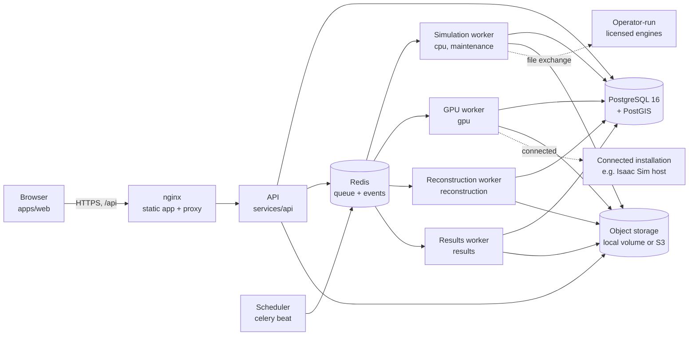
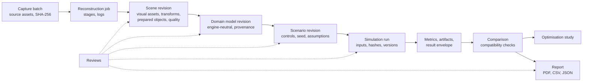
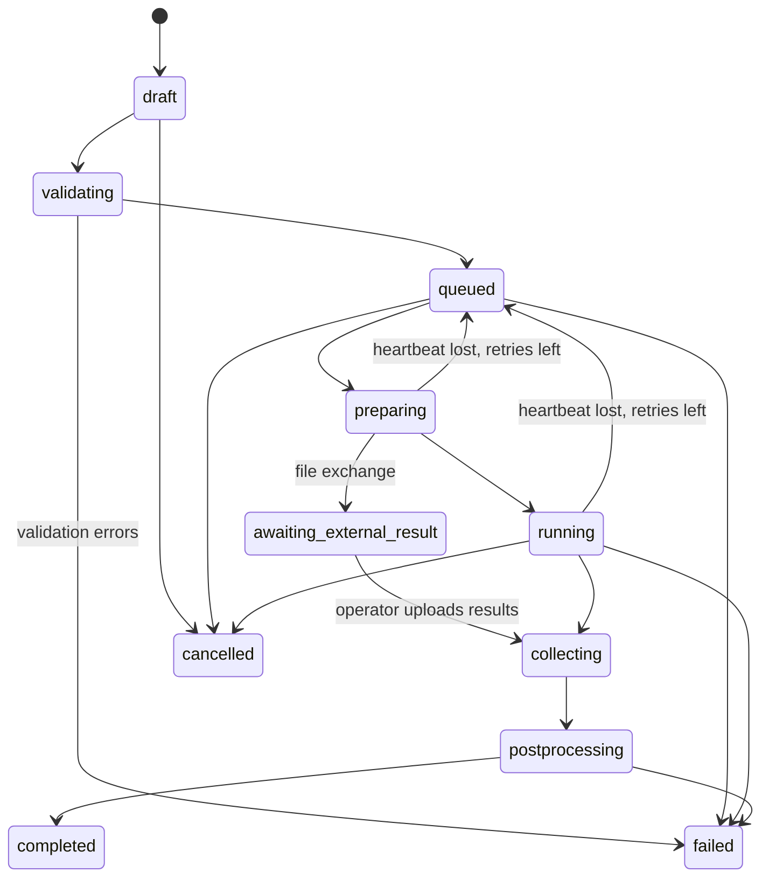

# Architecture

Parallel is a web application in front of an API, a PostgreSQL database with PostGIS, an object
store and a set of queue workers that run the engines. This document describes how the pieces fit
together and why. The rules every component follows are listed in [CLAUDE.md](../CLAUDE.md).

## Components

| Component | Code | Responsibility |
| --- | --- | --- |
| Browser application | `apps/web` | Projects, captures, the 3D scene workspace, models, scenarios, runs, comparisons, reports, CrashLens, the assistant. Talks only to the API. |
| API | `services/api` | Authentication, authorisation, validation, records, signed download URLs, task dispatch, server-sent progress events. Never runs engines. |
| Simulation worker | `workers/simulation` | Runs managed engines through adapters, imports operator-supplied results, runs optimisation studies, recovers lost runs, reports engine availability. |
| GPU worker | same code, `gpu` queue | Isaac Sim runs and Gaussian splat training on an RTX host. |
| Reconstruction worker | `workers/reconstruction` | Capture processing: verification, frames, blur and duplicate filtering, COLMAP, scale alignment, checks, scene publication. |
| Results worker | `workers/results` | Builds one manifest per report and renders the PDF, CSV and JSON from it. |
| Scheduler | `celery beat` | Recovery sweep every minute; engine availability refresh every five minutes. |
| Shared libraries | `packages/*` | Contracts, geometry, metrics, engine adapters, persistence, access control, jobs, storage, backups. |

The API dispatches work by task name (`parallel_core.jobs`), so it never imports worker code and
the browser application, API and workers can be deployed and scaled separately (spec 28.3).

## The workflow in records

- **Revisions.** Scenes, domain models and scenarios are edited as drafts and published as immutable
  revisions identified by a SHA-256 of their content. Editing a published revision creates a new one.
  A run freezes (publishes) the exact scenario and model revisions it uses and records their hashes.
- **Provenance.** Every important value carries a provenance record: measured, imported, assumption,
  algorithm estimate, AI-suggested, derived or synthetic, with source, uncertainty and notes
  ([data contracts](data-contracts.md)). AI-suggested values must be adopted by a person before a run
  will accept them.
- **Captured, prepared and hypothetical.** Visual assets (point clouds, Gaussian splats, meshes) show
  what was captured. Prepared objects are simplified analytical geometry used by engines. Hypothetical
  objects belong to scenarios. The workspace shows the three differently and never lets captured
  appearance act as walkable or solid geometry.
- **Quality states** (visual reconstruction, scale, measurements, model prepared, model reviewed,
  integration verified, calibrated) are assessed independently. Those that follow publication are
  read from the models, reviews and runs that cite the revision; calibration is never inferred.

## Runs

A run moves through recorded states; every transition is stored with its time and cause.

- **Submission** checks access, the adoption gate for AI content, engine availability (refused with
  the engine's real state and a next step when unavailable), the organisation's concurrency limit and
  monthly quota, and an idempotency key, so a retried request never creates a second run.
- **Validation** checks the scenario against its model and the engine's capability record before any
  work is queued. An invalid scenario fails in `validating` and never executes.
- **Execution.** The adapter materialises inputs from the model and scenario using controlled
  templates, hashes them, and runs the engine in its own isolated runtime as a separate process group
  with CPU, memory, output-size and wall-clock limits. The worker sends heartbeats and polls a
  cancellation flag; cancelling terminates the process group and discards partial outputs.
- **Collection and normalisation.** The adapter reads the engine's native outputs, emits metrics that
  must exist in the metric registry, writes time series and trajectories, and runs **native
  cross-checks** that compare normalised values with the engine's own outputs within stated tolerances.
  Everything is stored as artifacts with SHA-256 hashes, and a result envelope records revisions,
  engine and adapter versions, seed, settings, environment, input and output hashes, metrics,
  warnings, validation and processing history.
- **Recovery.** If a worker dies, its heartbeat stops. The recovery sweep re-queues the run while
  attempts remain and fails it with a recorded reason otherwise. Tasks are acknowledged late, so a lost
  worker's task is redelivered.

### Execution modes and availability

| Mode | Where the engine runs | Availability comes from |
| --- | --- | --- |
| Managed | On a Parallel worker, from a pinned runtime | The workers: each simulation worker checks the managed engines for its queues at start-up and every five minutes and records the result. The API uses a recent report when its own host cannot run the engine, and ignores reports older than fifteen minutes. |
| Connected | On an organisation's own installation reached by a registered connector | The organisation's registered installation and its last check |
| File exchange | Operated by a qualified person outside Parallel | The organisation's registered installation and licence confirmation. Parallel prepares the input package, the run waits in `awaiting_external_result`, and the operator uploads the result package, which is validated, size- and path-checked, normalised and labelled as imported. |

The [engine matrix](engine-matrix.md) lists each engine's modes, tested versions and limitations.

## Reconstruction

A reconstruction job runs eleven checkpointed stages (upload verification, media inspection, frame
extraction, frame filtering, pose estimation, training, visual export, geometry generation, scale and
orientation, quality assessment, publication) and can resume from the last valid stage. Details,
setup and an example are in [reconstruction.md](reconstruction.md).

## Comparison, optimisation and reports

- A **comparison** checks that runs differ only in their scenario changes (engine and adapter
  versions, horizon, initial conditions, population or demand, seeds, boundary conditions, model
  revision) and reports absolute and percentage differences with explicit rules for unavailable values
  and zero baselines. It also guards specific misreadings, such as a lower mean travel time that only
  reflects fewer completed trips.
- An **optimisation study** searches a declared parameter grid or coordinate path with real runs,
  common random numbers and an evaluation budget, and reports the *best tested candidate*, never an
  optimum. Adopting a candidate creates a normal scenario revision.
- A **report** is generated from a single manifest (runs, revisions, assumptions, provenance,
  cross-checks, reviews, limitations) into a PDF with charts and table twins, a metrics CSV and the JSON
  manifest itself, so the three always agree. CrashLens case reports add evidence, observations,
  interpretations with their basis, hypotheses and the statement that no fault is determined.

## CrashLens

Cases sit inside projects and are visible only to people assigned to them. Evidence originals are
hashed at receipt and protected by database triggers against change; redactions, enhancements and
annotations are separate derivatives with their own hashes, and every access is recorded in a
handling log. Observations record what evidence shows; interpretations record reasoning and must cite
the observations they rely on. Hypotheses link to evidence as supporting, contradicting or context,
and are compared by those links and by residuals from collision-engine analyses: never by probability.

## AI assistant

The assistant is optional; every workflow works without it. It uses a provider interface
(`services/api/.../assistant/providers.py`) with Anthropic and Gemini implementations, a scripted provider for
tests, and a disabled provider when no credentials are configured or the organisation forbids
external AI. It can act only through server-side tools (inspect the project, list models, check engine
capabilities, find missing inputs, draft and validate scenarios, estimate resources, submit runs,
read results, compare runs, draft reports), each authorised exactly as the same action would be for
the user. Drafts are marked AI-suggested and take effect only when a person adopts them. Case media are
sent to the model only when the organisation's policy allows it. Each message records the model that
served it and its token usage.

## Security

| Concern | Measure |
| --- | --- |
| Identity | Local accounts (scrypt password hashes, signed JWT sessions) or tokens from an OIDC identity provider. |
| Authorisation | Checked on the server for every request: organisation role (admin, member), project role (editor, reviewer, viewer) and case assignment (`require_scoped`). Inaccessible records answer 404, so their existence is not revealed; lists, counts and activity feeds exclude case records the user cannot see. |
| Audit | Consequential changes write an audit event with actor, object, project and case. |
| Uploads | Size limits enforced while streaming, SHA-256 at receipt, file type checked against content signatures, originals stored once and never overwritten. |
| Archives | Result packages are extracted with traversal, absolute-path, symlink, member-size, total-size and compression-ratio checks. |
| Engines | Controlled templates and arguments only; uploaded scripts and solver plugins are never executed. Each engine runs in an isolated runtime with a minimal environment and resource limits, as an unprivileged user in the container images. |
| Downloads | Short-lived signed URLs (HMAC for local storage, presigned for S3). |
| Secrets | Read from the environment and never stored in the database; production refuses to start with a weak signing key. |
| Backups | `python -m parallel_core.backup` with manifest verification ([deployment](deployment.md#backups)). |

## Observability

Runs record queue, start and finish times, attempts, worker, engine and adapter versions, per-state
durations and artifact sizes; reconstruction jobs record per-stage timings and logs; assistant messages
record usage; workers record engine availability. `GET /api/v1/health` reports API and database health
and `GET /api/v1/metrics` exposes the metric registry used by every result.
